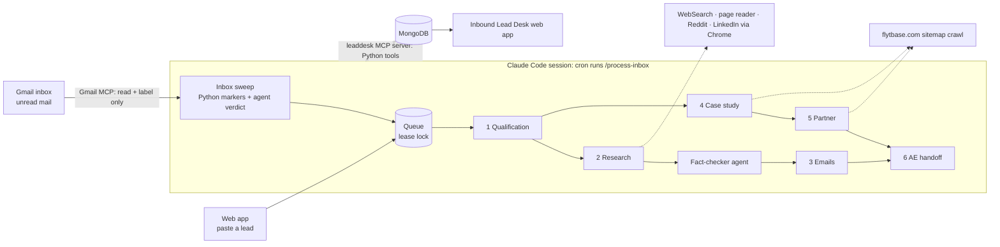

# FlytBase Inbound Lead Desk: an AI agent for inbound BDR work

> **Start here**
> - **[Walkthrough deck (PDF)](docs/Inbound-Lead-Desk-Walkthrough.pdf)**: the whole system in 15 pages, with real screenshots of the live run
> - **Walkthrough video:** _[add your Loom / YouTube unlisted link here]_ · script synced to the PDF page by page: [docs/VIDEO_SCRIPT.md](docs/VIDEO_SCRIPT.md)
> - **Live run output (the assignment's SQM lead):** [REPORT.md](outputs/run_2026-11-05_19-32-11/REPORT.md) · [REPORT.pdf](outputs/run_2026-11-05_19-32-11/REPORT.pdf) · [run folder](outputs/run_2026-11-05_19-32-11/) (one JSON per stage, sources, agent trace), passing 39/39 checks
> - **A second lead (E.ON test):** [REPORT.md](outputs/run_2026-11-05_20-03-27/REPORT.md) · [REPORT.pdf](outputs/run_2026-11-05_20-03-27/REPORT.pdf)
> - **Submission checklist:** [SUBMISSION.md](SUBMISSION.md)

An internal V1 system. An inbound lead arrives by email, and the agent produces the six artifacts the FlytBase BDR assignment asks
for: **qualification, deep account research, an adaptive email sequence, a case-study match, a partner/GTM recommendation and an AE
handoff**. It stores everything in MongoDB and shows it in an internal web app.

> *"You are not writing the answers. You are building the thing that writes the answers."* Nothing here is hand-written per lead.
> The stage logic lives in versioned agent files, numbers and checks are computed in Python, and every step is logged.

## How it works

| Piece | What it is | Why |
|---|---|---|
| **Claude Code** | The agent. The skill `.claude/skills/process-inbox` is the orchestrator; `.claude/agents/stage-*.md` holds one subagent per PDF stage, plus an independent `research-fact-checker` | Orchestration over single prompts: each stage has its own instructions, tools and output schema, and the stages run in parallel where the data allows |
| **Session cron** | `CronCreate */5 * * * *` → `/process-inbox` | Checks the inbox every 5 minutes while the session is open |
| **Gmail MCP** (claude.ai connector) | Reads unread mail and adds `LeadDesk/*` labels | Send, reply, forward, draft, trash and unlabel are **denied** in `.claude/settings.json`. Mail stays unread |
| **leaddesk MCP server** (`leaddesk_mcp/server.py`, Python) | 23 tools: inbox log, lead queue with lease lock, source registry, page and PDF reader, Reddit search (Arctic Shift), flytbase.com crawls, scoring, fact-check removal, partner verification, PDF checklist, reports | "The AI reads, Python decides": everything that must be exact is plain code, and the agent can't skip it |
| **MongoDB** | `leads`, `sources` (raw text per S#), `inbox_log`, `agent_state` | One store shared by the agent and the web app |
| **Web app** (`app/`) | FastAPI + plain JS: leads, live progress, a tab per stage with its PDF checklist, inbox verdicts, sources, agent trace and notes | The BDR's workspace. It never calls an AI and never sends email. (A demo CRM with lead routing exists in `app/crm.py` but is switched off: `LEADDESK_CRM=1` plus `SHOW_CRM` in `app.js`) |

## The six stages, mapped one-to-one to the PDF

| PDF stage | Subagent | What Python does (`agent/stages/`, `agent/store.py`) |
|---|---|---|
| 1 Qualification (MEDDPICC) | `stage-1-qualify`: extracts the known info from the raw email, sets known/partial/unknown for the 8 MEDDPICC elements, rates 7 ICP fit factors 0-5 with evidence | Validates the shape and **computes the ICP fit, completeness, priority and tier**, showing the full calculation |
| 2 Deep account research | `stage-2-research`: plans 12-16 queries over org structure, budget signals, news, investor letters, operations and tech adoption; finds sources with WebSearch, Reddit and LinkedIn; writes the brief citing only `S#` | Every page is read by Python and stored with its **raw text** (HTML or PDF). Then `research-fact-checker`, a separate agent, judges each claim against the stored text, and Python **removes unsupported claims** and any claim citing no stored source |
| 3 Response generation | `stage-3-emails`: 4 emails plus reply branches, written from the sourced [inbound reply playbook](.claude/agents/references/inbound-reply-playbook.md) (an inbound reply, not cold outreach) | Checks that every email cites **kept research IDs** and targets **real Stage 1 gaps**, and lints 10 playbook rules (length, questions, two time slots, banned phrases, close-the-loop…) |
| 4 Case study matching | `stage-4-case-study`: adds `site:flytbase.com` search results, then ranks on industry, use case and context | **Crawls the whole sitemap**, reads every case study and pre-scores it: keyword overlap, plus `mentions_referrer` and `mentions_lead_company` built from the names in the email, **not hard-coded** |
| 5 Partner identification | `stage-5-partner`: direct vs partner-led, justified by region, complexity and availability | Reads the partner directory and **verifies every partner name appears in a stored source** |
| 6 AE handoff | `stage-6-handoff`: buyer context, status, top 3 findings, case study, next step | Checks that the highlights cite research that survived the fact-check |

Every stage output gets a **PDF checklist**: each bullet from the assignment is checked in Python and shown in the app and in the
report. The run order follows the data: 1 → (2 ∥ 4) → fact-check → (3 ∥ 5) → 6.

## Inspecting a run

Each lead gets `outputs/run_<date-time>/` with:

| File | Contents |
|---|---|
| `REPORT.md` / `REPORT.html` | The six-stage report with the requirements check and clickable sources |
| `0_lead.json` … `6_handoff.json` | Raw output of each stage, including `pdf_checklist` |
| `sources.json` | Every source with its URL, kind and the query that found it (the raw text is in MongoDB) |
| `trace.jsonl` | One line per subagent call: which agent file ran, its input and exactly what it saved |
| `input.txt` | The raw inbound email, the only input |

The Gmail sweep decisions (marker score, verdict and reason for every unread mail) are on the web app's **Inbox** page.

## Run it

1. `py -m pip install -r requirements.txt`
2. Put a MongoDB connection string in `.env` (git-ignored): `mongodb=mongodb+srv://...`
3. Web app: `py -m app.server` (or `app.bat`), then open http://127.0.0.1:8000. It binds to this machine only.
4. Agent: open Claude Code in this folder, approve the `leaddesk` MCP server, and make sure the Gmail connector is connected.
   Run `/process-inbox` once, then start the cron: *"create a cron every 5 minutes that runs /process-inbox"*. For LinkedIn
   research, keep Chrome open with the Claude in Chrome extension.
5. Send a lead to the connected inbox from another address (for example the text of `input/lead_sqm.txt`), or paste one in the web app,
   or run `py run.py --input input/lead_sqm.txt` (queues a file). To run a single lead immediately, use `/process-lead input/lead_sqm.txt`.

Tests: `py -m pytest tests` covers scoring, fact-check removal, partner verification, the inbox markers and a full store flow on a throwaway database.

## Honest limitations

- **The scheduler lives in the Claude Code session.** It stops when the session closes, and recurring session crons expire after 7 days.
  A production version would run headless (`claude -p /process-inbox`) from a real scheduler, or use a Gmail push webhook.
- The agent's judgement steps (verdicts, ratings, writing) are model output. Python bounds them (schemas, citations, verification, checklists), but a human still reviews the emails before sending.
- LinkedIn research depends on the Chrome extension being available to the session. Without it the agent falls back to public pages.
- The inbox sweep looks at the last 2 days of unread mail, so an old backlog is ignored on purpose.

`outputs/legacy_gemini/` holds the v0 runs from the earlier Python + Gemini pipeline, kept for history only.
